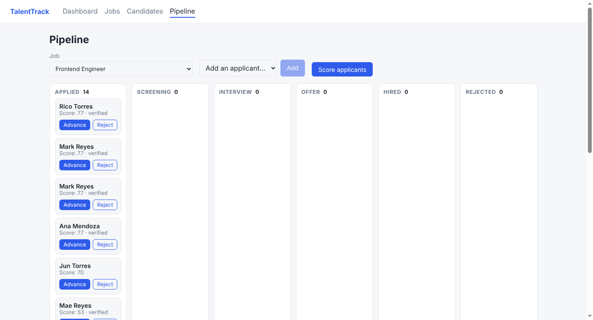

# TalentTrack

A small applicant tracking system for remote hiring: post jobs, add candidates, move
them through a hiring pipeline, and score every applicant at once with a multithreaded
screening service.

**Stack:** Django + Django REST Framework · React + Redux Toolkit · Selenium (Page Object Model) ·
Python multithreading · Docker · Google Cloud Run, Cloud SQL, Cloud Build



## Features

- **REST API** for jobs, candidates and applications with search, filtering and pagination
- **Hiring pipeline** with enforced status rules (applied → screening → interview → offer → hired, or rejected)
- **Bulk screening** that calls a (simulated) external verification API for every applicant
  concurrently with a `ThreadPoolExecutor`, about **7x faster** than doing it one by one
- **React + Redux** single-page app: normalized state, async thunks, memoized selectors
- **Automated tests at three levels**: 35 unit/API tests (pytest), 6 reducer tests (Vitest),
  9 Selenium browser tests using the Page Object Model, plus screenshots on failure
- **CI/CD**: GitHub Actions runs every test; Cloud Build tests, builds and deploys to Cloud Run

## Project layout

```
talenttrack/
├── backend/
│   ├── config/                 settings (env-driven), urls
│   ├── recruiting/
│   │   ├── models.py           Job, Candidate, Application + pipeline rules
│   │   ├── serializers.py      validation, skill normalization
│   │   ├── views.py            DRF ViewSets, custom actions (advance, screen), stats
│   │   ├── screening.py        ★ the multithreading code
│   │   ├── management/commands seed_demo, screen_benchmark
│   │   └── tests/              unit + API integration tests
│   └── e2e/                    ★ Selenium tests
│       ├── pages/              Page Objects
│       └── test_ui.py
├── frontend/src/
│   ├── app/store.js            Redux store
│   ├── features/*/…Slice.js    ★ Redux Toolkit slices + async thunks
│   └── pages/                  Dashboard, Jobs, Candidates, Pipeline
├── Dockerfile                  multi-stage: build React, then Python runtime
├── cloudbuild.yaml             ★ GCP CI/CD pipeline
├── .github/workflows/ci.yml
└── docs/
    ├── INTERVIEW_GUIDE.md      ★ study guide and likely interview questions
    └── GCP_DEPLOY.md           step-by-step Google Cloud deployment
```

## Run it locally

Requirements: Python 3.11+, Node 20+, Google Chrome (for Selenium).

```bash
# 1. Backend
cd backend
python -m venv .venv
.venv\Scripts\activate            # Windows   (macOS/Linux: source .venv/bin/activate)
pip install -r requirements.txt
python manage.py migrate
python manage.py seed_demo         # 3 jobs, 40 candidates, ~57 applications
python manage.py runserver         # API on http://127.0.0.1:8000/api/

# 2. Frontend (second terminal)
cd frontend
npm install
npm run dev                        # app on http://localhost:5173 (proxies /api to Django)
```

To run it the way production does (Django serving the built React app):
`npm run build` in `frontend/`, then open http://127.0.0.1:8000.

## Run the tests

```bash
cd frontend && npm test                     # Redux reducer tests (Vitest)
cd frontend && npm run build                # Selenium tests need the built app

cd backend
pytest recruiting/tests                     # unit + API tests
pytest -m e2e                               # Selenium browser tests (headless Chrome)
HEADED=1 pytest -m e2e                      # watch the browser (Windows: set HEADED=1)
pytest                                      # everything
```

See multithreading in action:

```bash
python manage.py screen_benchmark
#   sequential :   2804 ms  (1 thread)
#   threaded   :    404 ms  (8 threads)
#   speed-up   :   6.9x
```

## API

| Method | Endpoint | Purpose |
|---|---|---|
| GET/POST | `/api/jobs/` | list (`?is_open=true&search=django`) / create |
| GET/PATCH/DELETE | `/api/jobs/{id}/` | read / update / delete |
| POST | `/api/jobs/{id}/screen/` | score all applicants with threads (`{"sequential": true}` to compare) |
| GET/POST | `/api/candidates/` | list (`?search=`) / create |
| GET/POST | `/api/applications/` | list (`?job=1&status=interview`) / apply |
| POST | `/api/applications/{id}/advance/` | move to the next stage |
| POST | `/api/applications/{id}/status/` | `{"status": "rejected"}` |
| GET | `/api/stats/` | dashboard counts |
| GET | `/api/health/` | health check for Cloud Run |

DRF also gives a clickable browsable API at http://127.0.0.1:8000/api/.

## Deploy to Google Cloud

See [docs/GCP_DEPLOY.md](docs/GCP_DEPLOY.md).

## What I'd add next

- Authentication (DRF token/JWT) and per-recruiter permissions
- Résumé uploads to Cloud Storage
- Move screening to a background queue (Cloud Tasks / Celery) so large batches don't hold an HTTP request open
- Allure or pytest-html reports and QA metrics (pass rate, flaky tests) in CI
# talenttrack
